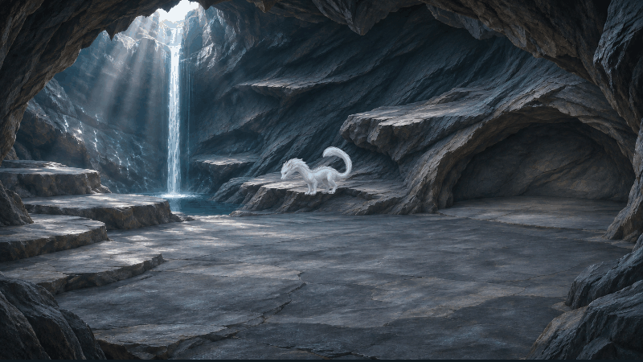

# 棲雲洞 · White Dragon Game

以純白東方幼龍為主角的 Unity 2.5D 洞穴互動遊戲。幼龍會自主走動、上下跳躍岩棚、盤身睡覺，並回應照顧者的點擊。

## 開啟專案

1. 使用 **Unity 6000.6.7f1**，在 Unity Hub 選擇 Add project from disk，選取此資料夾。
2. 等待 Package Manager 還原相依套件及素材匯入。
3. 開啟 `Assets/DragonCave/Scenes/DragonCave.unity`。
4. Game 視窗建議選擇 **16:9**，按 **Play**。

`Library`、`Temp`、`Logs`、`UserSettings` 等由 Unity 在本機重新產生，不包含在 repo。

## 互動方式

- 幼龍自主移動，點地面不會指定移動。
- 點擊清醒的幼龍：先轉頭回應，再顯示「吐雲」。
- 點擊睡覺的幼龍：保持盤身、小幅睜眼回應；選擇「喚醒」才播放完整起身動畫。
- 跳躍途中點擊，會等四腳落地後才回應。
- 點擊空白處關閉互動選項。
- 鼻息是少量、快速散開的薄霧，呼出時雙眼閉合；睡眠時也會自動出現。
- 蓄力吐雲會先吸氣、擴張腹部，再吐出遮住龍與背景的大片雲霧，緩慢散開。

## 場景與動作

洞穴採清冷瀑布天光與不規則自然岩棚。角色、陰影及互動效果依路線深度縮放；瀑布與水潭是不可進入區域。

已導入確認過的逐格動畫：

| 動作 | 幀數 |
| --- | ---: |
| 行走循環 | 8 |
| 上跳／落地 | 16 |
| 下跳／落地 | 16 |
| 喚醒 | 12 |
| 睡眠點擊回應 | 8 |
| 蓄力吐雲 | 16 |
| 清醒／睡眠鼻息 | 各 12 |

本版幼龍不會飛行，尚未包含狩獵、餵食、撫摸、商店或成長進化。角色採逐格圖像與深度路線組成，並非完整骨架驅動的 3D 模型。

## 專案結構

- `Assets/DragonCave/`：場景、遊戲邏輯、素材與編輯器匯入工具。
- `Packages/`、`ProjectSettings/`：相依套件及專案設定。
- `Previews/`：造型、動作確認圖與動畫預覽；`ImportedReview/` 為遊戲內播放擷取。
- `AgentScripts/`：透過本機 Unity Pipeline 執行的功能驗證腳本，不屬於玩家遊戲程式。

動畫來源對照及素材準備方式見 `Assets/DragonCave/Art/Approved/SOURCE_MAPPING.md`。

## 素材註記

洞穴與幼龍圖片以內建影像生成功能製作，再依確認素材整理導入。中文字型為辰宇落雁體，授權見 `Assets/DragonCave/Fonts/OFL-ChenYuluoyan.txt`。專案中的其他套件與字型依各自附帶的授權條款使用。
